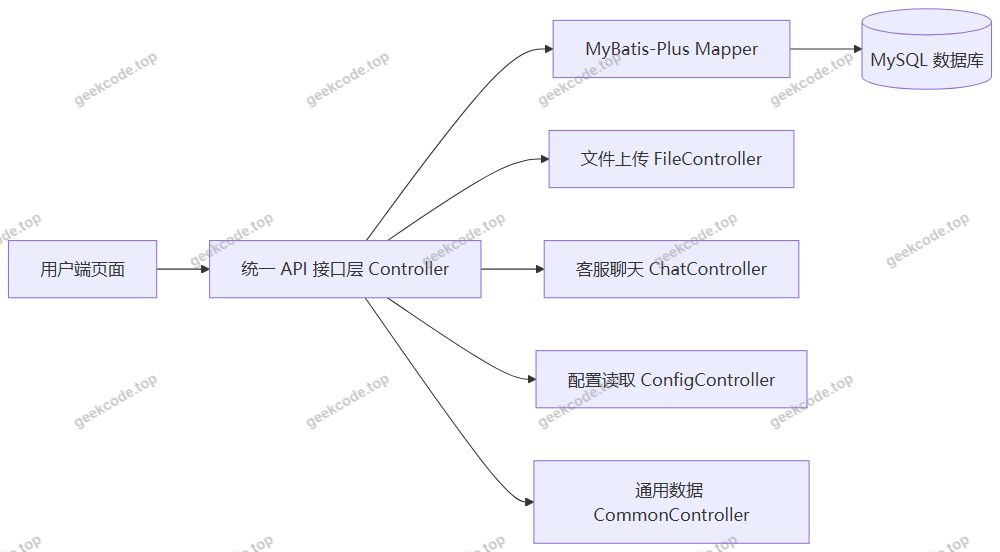
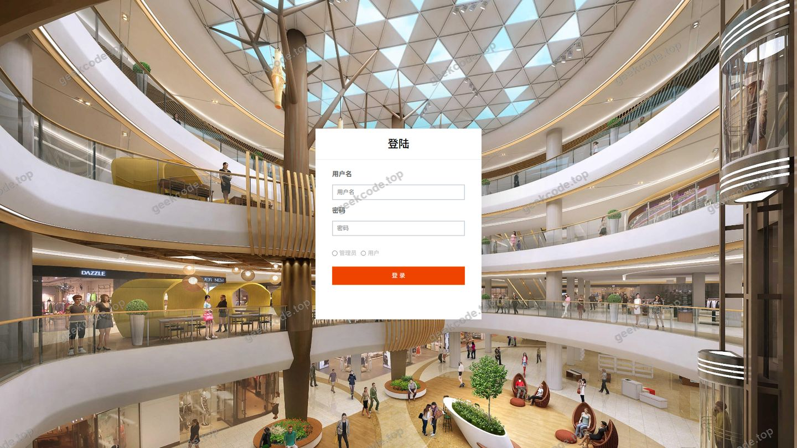
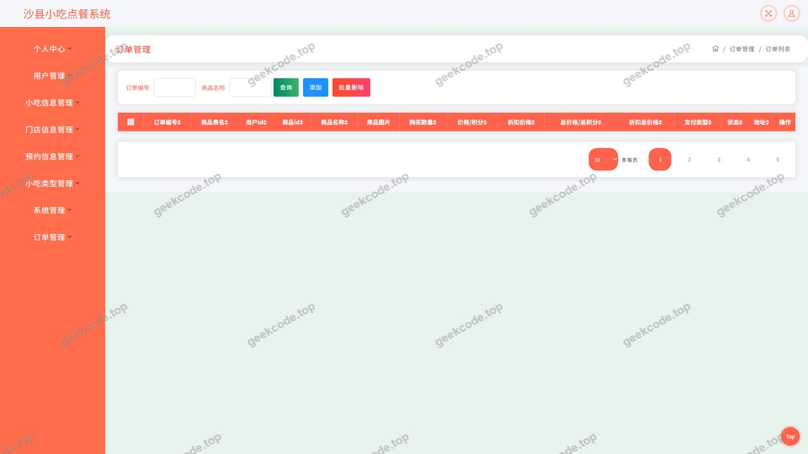
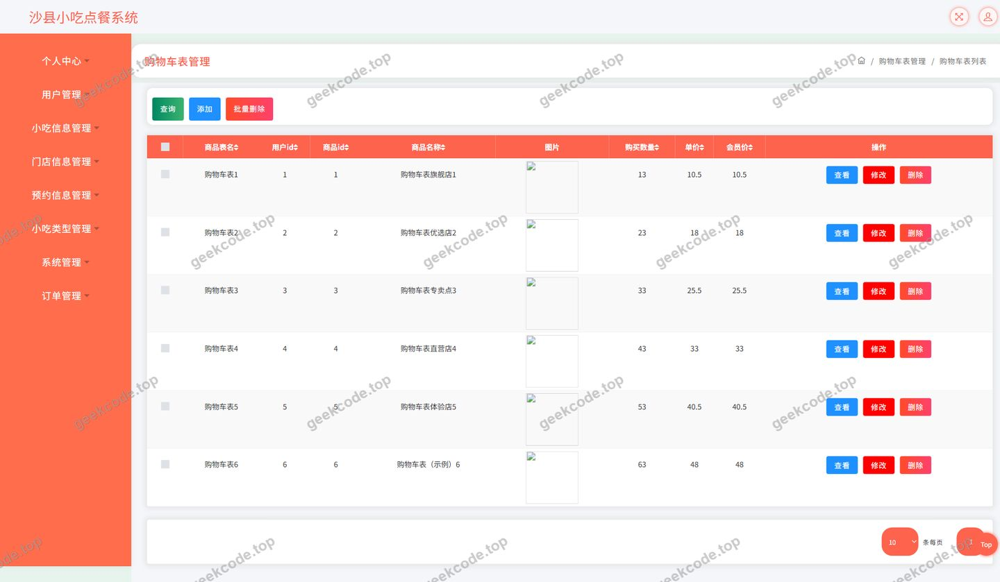
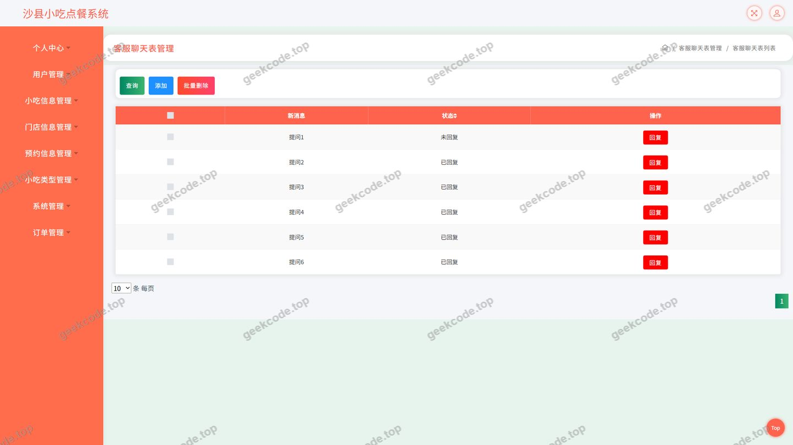
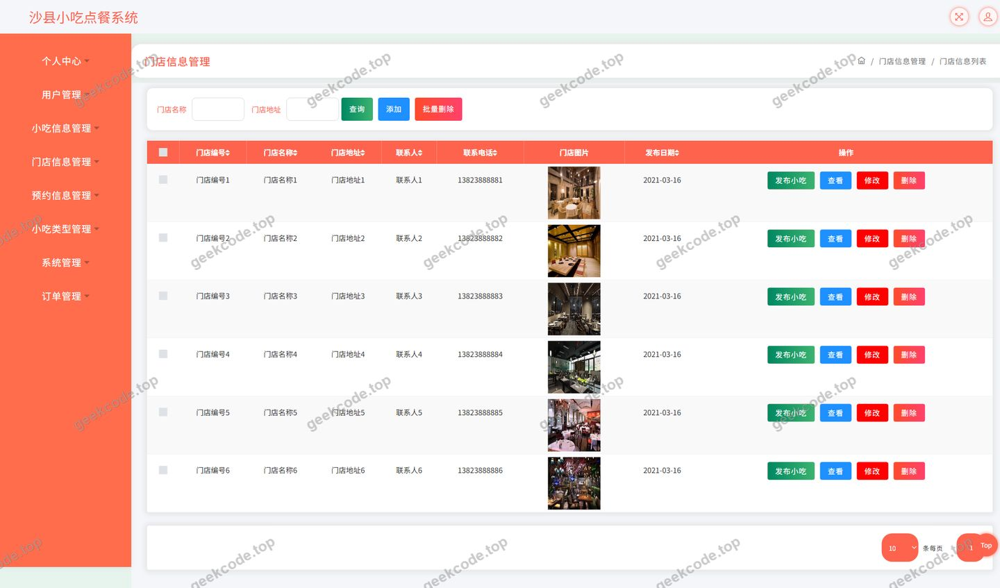
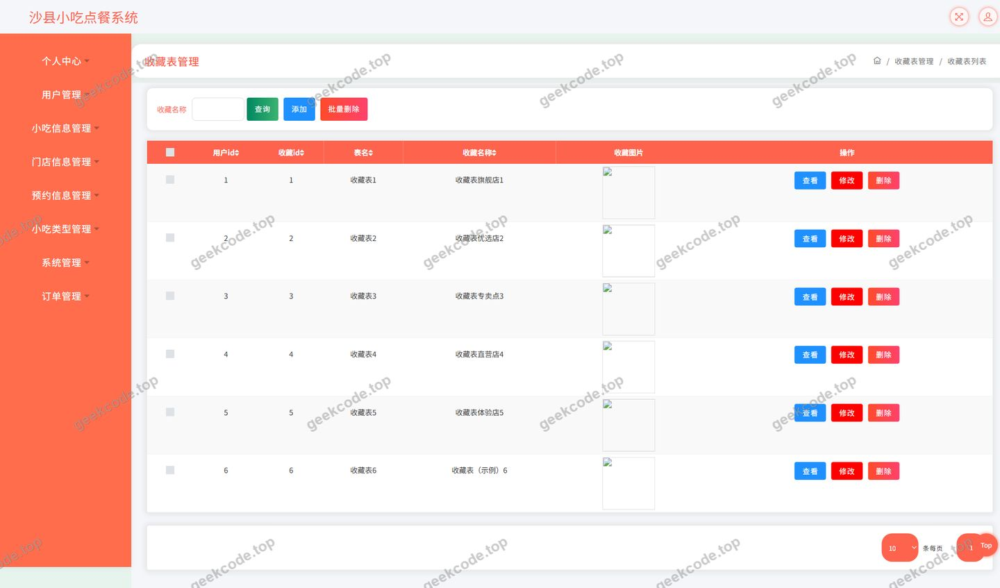
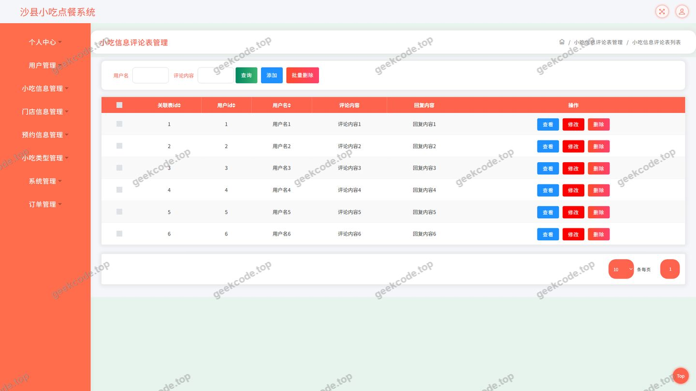
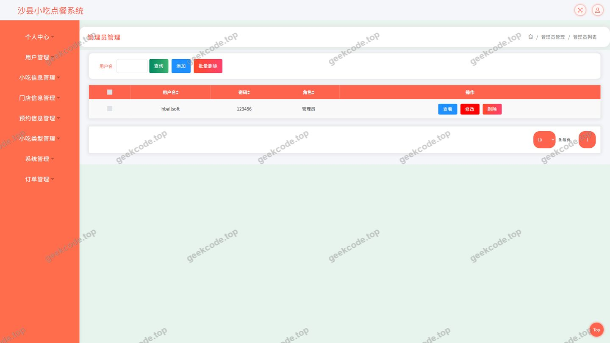

# java项目沙县小吃点餐系统java毕业设计

> 🎓 **计算机毕业设计 · java项目沙县小吃点餐系统java毕业设计**
>
> 本仓库只放**项目介绍 + 运行截图**（截图是站点带水印的原图，存在仓库 `images/` 里）。
>
> 👉 **完整可运行源码 / 数据库脚本 / 部署文档：[点我获取](https://geekcode.top/archives/java%E9%A1%B9%E7%9B%AE%E6%B2%99%E5%8E%BF%E5%B0%8F%E5%90%83%E7%82%B9%E9%A4%90%E7%B3%BB%E7%BB%9Fjava%E6%AF%95%E4%B8%9A%E8%AE%BE%E8%AE%A1?utm_source=github)**
>
> 💬 咨询微信：**ir9372**　|　🌐 更多项目：[极客代码 geekcode.top](https://geekcode.top/?utm_source=github)
>
> 📌 项目详情页：<https://geekcode.top/archives/java%E9%A1%B9%E7%9B%AE%E6%B2%99%E5%8E%BF%E5%B0%8F%E5%90%83%E7%82%B9%E9%A4%90%E7%B3%BB%E7%BB%9Fjava%E6%AF%95%E4%B8%9A%E8%AE%BE%E8%AE%A1?utm_source=github>

<table><td width="230" align="center"> <b>扫码加微信 ir9372</b></td><td valign="middle">📦 源码 = 项目介绍 + 全部运行截图 + 数据库 + 部署文档 👉 点上方任意截图，直接跳到 <b>极客代码 geekcode.top</b> 详情页</td></table>

---

<h1>java项目_沙县小吃点餐系统_java毕业设计</h1>
<h2>项目概述</h2>

沙县小吃点餐系统是一个面向小吃门店线上点餐场景的 Java Web 后端项目，项目类型为纯 API 服务。系统围绕“小吃信息浏览、门店信息浏览、购物车、订单、地址、收藏、评论、客服聊天、个人中心”等业务环节，为普通用户提供线上点餐与信息查询能力。用户可查看小吃与门店信息，对门店和小吃发表评论，将商品加入购物车并生成订单，维护收货地址与收藏记录，并通过客服聊天进行咨询。项目采用 Spring MVC 分层结构，持久层使用 MyBatis-Plus，数据库连接池使用 Druid，并通过 JUnit 支持单元测试。项目代码上下文未包含前端路由与后台路由，页面截图展示的是面向用户的业务界面。该系统适用于小吃餐饮门店的线上点餐信息管理、毕业设计演示以及 Java Web 分层开发学习等场景。

<h2>技术架构</h2>
<h3>前后端架构</h3>

本项目为纯 API 后端服务，代码上下文中未提供前台路由与后台路由，前端页面通过 HTTP 请求调用后端接口完成数据交互。后端以 Controller 作为统一接口入口，覆盖用户、地址、购物车、订单、门店信息、小吃信息评论、门店信息评论、收藏、客服聊天、文件上传、配置与通用数据等业务。整体调用关系如下：

从 Controller 命名可以看出，系统按业务域拆分接口，包括 AddressController、CartController、ChatController、CommonController、ConfigController、DiscussmendianxinxiController、DiscussxiaochixinxiController、FileController、MendianxinxiController、OrdersController、StoreupController、UserController。该结构便于按模块维护接口，也便于后续扩展。

<h3>数据库设计要点</h3>

根据现有 Controller 与页面功能，可确认系统涉及以下主要数据实体：用户信息、收货地址、购物车、订单、门店信息、小吃信息、门店信息评论、小吃信息评论、收藏记录、客服聊天记录、文件与配置数据。具体表名、字段定义、主外键关系、索引设计在现有信息中未提供，无法确定。数据库访问层采用 MyBatis-Plus，适合进行单表 CRUD、条件构造与分页查询；连接池采用 Druid，用于管理数据库连接资源。

<h3>核心技术选型理由</h3>
<ul>
<li><strong>Spring MVC</strong>：通过 Controller 统一暴露接口，按业务模块拆分，结构清晰，便于维护和联调。</li>
<li><strong>MyBatis-Plus</strong>：在 MyBatis 基础上提供通用 CRUD 能力，减少重复 SQL 编写，适合用户、地址、购物车、订单、收藏、评论等数据操作。</li>
<li><strong>Druid</strong>：作为数据库连接池，负责连接复用与资源管理，提升数据库访问的稳定性。</li>
<li><strong>JUnit</strong>：用于后端单元测试，支持对业务逻辑与接口进行测试验证。</li>
<li><strong>文件上传独立接口</strong>：FileController 单独承担文件上传相关请求，便于统一处理文件资源。</li>
<li><strong>配置与通用接口分离</strong>：ConfigController 与 CommonController 分别承担配置读取与通用数据访问职责，降低业务接口耦合度。</li>
</ul>
<h2>功能模块</h2>
<h3>前台用户端</h3>

前台用户端围绕导航菜单“小吃信息、门店信息”和个人中心菜单“个人中心、我的订单、我的地址、我的收藏”展开，主要功能模块如下：

<table>
<thead>
<tr>
<th>功能模块</th>
<th>简要描述</th>
</tr>
</thead>
<tbody><tr>
<td>登录</td>
<td>提供用户登录入口，页面截图包含登录界面。</td>
</tr>
<tr>
<td>小吃信息</td>
<td>展示小吃信息，用户可查看小吃内容，并可对小吃信息发表评论。</td>
</tr>
<tr>
<td>门店信息</td>
<td>展示门店信息，用户可查看门店内容，并可对门店信息发表评论。</td>
</tr>
<tr>
<td>购物车</td>
<td>用户将所选商品加入购物车，并在购物车页面进行查看与管理。</td>
</tr>
<tr>
<td>订单</td>
<td>用户查看和管理自己的订单，对应“我的订单”入口与订单页面。</td>
</tr>
<tr>
<td>地址</td>
<td>用户维护个人收货地址，对应“我的地址”入口。</td>
</tr>
<tr>
<td>收藏</td>
<td>用户收藏感兴趣的小吃或门店信息，对应“我的收藏”入口与收藏页面。</td>
</tr>
<tr>
<td>客服聊天</td>
<td>用户通过客服聊天页面与客服进行在线沟通。</td>
</tr>
<tr>
<td>个人中心</td>
<td>汇总个人相关信息与功能入口，对应“个人中心”菜单。</td>
</tr>
<tr>
<td>用户信息</td>
<td>提供用户相关信息展示与维护入口，页面截图包含用户页面。</td>
</tr>
<tr>
<td>评论</td>
<td>包括小吃信息评论与门店信息评论，分别由 DiscussxiaochixinxiController 与 DiscussmendianxinxiController 提供接口支持。</td>
</tr>
</tbody></table>
<h3>后台管理端</h3>

根据现有信息，项目未提供后台路由，代码上下文中也未包含后台管理页面，无法确定后台管理端的具体功能模块与页面结构。现有 Controller 主要作为统一 API 接口层，为前台业务页面提供数据访问能力，覆盖用户、地址、购物车、订单、门店信息、小吃信息评论、门店信息评论、收藏、客服聊天、文件上传、配置与通用数据等接口。

<h2>用户角色与权限</h2>

根据现有页面截图与 Controller 信息，可确认的角色及权限如下：

<table>
<thead>
<tr>
<th>角色</th>
<th>可访问功能模块</th>
<th>权限说明</th>
</tr>
</thead>
<tbody><tr>
<td>普通用户</td>
<td>登录、小吃信息、门店信息、小吃信息评论、门店信息评论、购物车、订单、地址、收藏、客服聊天、个人中心、用户信息</td>
<td>可浏览小吃与门店信息，发表评论，管理购物车、订单、地址与收藏，使用客服聊天与个人中心功能。</td>
</tr>
<tr>
<td>管理员/后台管理角色</td>
<td>根据现有信息无法确定</td>
<td>项目未提供后台路由与后台管理页面，无法确定管理员角色及其可访问的功能模块。</td>
</tr>
<tr>
<td>客服角色</td>
<td>客服聊天</td>
<td>ChatController 提供客服聊天接口，但是否设置独立客服角色及其权限范围，根据现有信息无法确定。</td>
</tr>
</tbody></table>
<h2>项目特色与创新点</h2>
<ol>
<li><strong>点餐业务闭环</strong>：围绕小吃信息浏览、购物车、订单、地址与收藏形成完整的线上点餐操作链路，满足用户从选品到下单的基本业务需求。</li>
<li><strong>双评论体系</strong>：分别提供小吃信息评论与门店信息评论接口，用户可针对小吃和门店两个维度发表评价，增强信息互动性。</li>
<li><strong>客服聊天能力</strong>：通过 ChatController 提供客服聊天接口，为用户咨询与沟通提供支持。</li>
<li><strong>个人中心集中管理</strong>：将订单、地址、收藏等个人业务集中到个人中心菜单，便于用户统一查看与管理。</li>
<li><strong>按业务域拆分接口</strong>：Controller 按用户、地址、购物车、订单、门店、评论、收藏、聊天、文件、配置等业务域拆分，职责边界清晰，便于维护与扩展。</li>
<li><strong>MyBatis-Plus 提升开发效率</strong>：持久层采用 MyBatis-Plus，减少重复 CRUD 代码，适合毕业设计项目在有限周期内完成多模块数据操作。</li>
<li><strong>Druid 连接池管理</strong>：通过 Druid 统一管理数据库连接资源，为多接口并发访问提供基础支撑。</li>
</ol>
<h2>部署环境</h2>
<table>
<thead>
<tr>
<th>软件/组件</th>
<th>作用</th>
<th>说明</th>
</tr>
</thead>
<tbody><tr>
<td>JDK</td>
<td>Java 运行环境</td>
<td>项目为 Java Web 后端项目，需安装 JDK；具体版本在现有信息中未提供，无法确定。</td>
</tr>
<tr>
<td>Maven</td>
<td>依赖管理与项目构建</td>
<td>项目依赖包括 junit、spring-core、spring-context、spring-context-support、spring-tx、spring-aop、spring-beans、spring-jdbc、spring-web、spring-webmvc 等，需通过 Maven 管理。</td>
</tr>
<tr>
<td>MySQL</td>
<td>关系型数据库</td>
<td>用于存储用户、地址、购物车、订单、门店信息、小吃信息、评论、收藏、聊天等业务数据；具体数据库版本未提供。</td>
</tr>
<tr>
<td>Druid</td>
<td>数据库连接池</td>
<td>项目技术栈包含 Druid，用于数据库连接管理。</td>
</tr>
<tr>
<td>MyBatis-Plus</td>
<td>持久层框架</td>
<td>用于数据库访问与 CRUD 操作。</td>
</tr>
<tr>
<td>Spring 相关依赖</td>
<td>后端基础框架</td>
<td>包括 spring-web、spring-webmvc、spring-jdbc、spring-tx、spring-aop 等，支撑接口层与业务层运行。</td>
</tr>
<tr>
<td>JUnit</td>
<td>单元测试</td>
<td>项目依赖中包含 junit，用于测试支持。</td>
</tr>
</tbody></table>

项目为纯 API 后端服务，代码上下文未包含前端工程与前端路由，因此不涉及 Node.js 或微信开发者工具等前端构建与运行环境。文件上传功能由 FileController 提供，部署时需配置文件存储相关参数；具体配置项与存储路径根据现有信息无法确定。

<h2>五、技术特性</h2>
<ul>
<li>使用 MyBatis-Plus 简化数据访问层开发</li>
</ul>
<h2>六、功能模块截图</h2>
<h3>后台管理端</h3>
<h4>页面-登录</h4>

<h4>页面-订单</h4>

<h4>页面-购物车</h4>

<h4>页面-客服聊天</h4>

<h4>页面-门店信息</h4>

<h4>页面-门店信息评论</h4>

<h4>页面-收藏</h4>

<h4>页面-小吃信息评论</h4>

<h4>页面-用户</h4>

---

## 获取完整源码

| 项目 | 说明 |
| --- | --- |
| 项目名 | java项目沙县小吃点餐系统java毕业设计 |
| 运行截图 | 本文 10 张（站点带水印原图，仓库 `images/` 目录） |
| 完整源码 | [https://geekcode.top/archives/java%E9%A1%B9%E7%9B%AE%E6%B2%99%E5%8E%BF%E5%B0%8F%E5%90%83%E7%82%B9%E9%A4%90%E7%B3%BB%E7%BB%9Fjava%E6%AF%95%E4%B8%9A%E8%AE%BE%E8%AE%A1?utm_source=github](https://geekcode.top/archives/java%E9%A1%B9%E7%9B%AE%E6%B2%99%E5%8E%BF%E5%B0%8F%E5%90%83%E7%82%B9%E9%A4%90%E7%B3%BB%E7%BB%9Fjava%E6%AF%95%E4%B8%9A%E8%AE%BE%E8%AE%A1?utm_source=github) |
| 咨询微信 | **ir9372**（备注：jingpin-yuanma） |
| 更多项目 | [极客代码 geekcode.top](https://geekcode.top/?utm_source=github) |

> 需要源码、部署、改配置、跑不起来等问题，加微信 ir9372 沟通，说明项目名即可。
